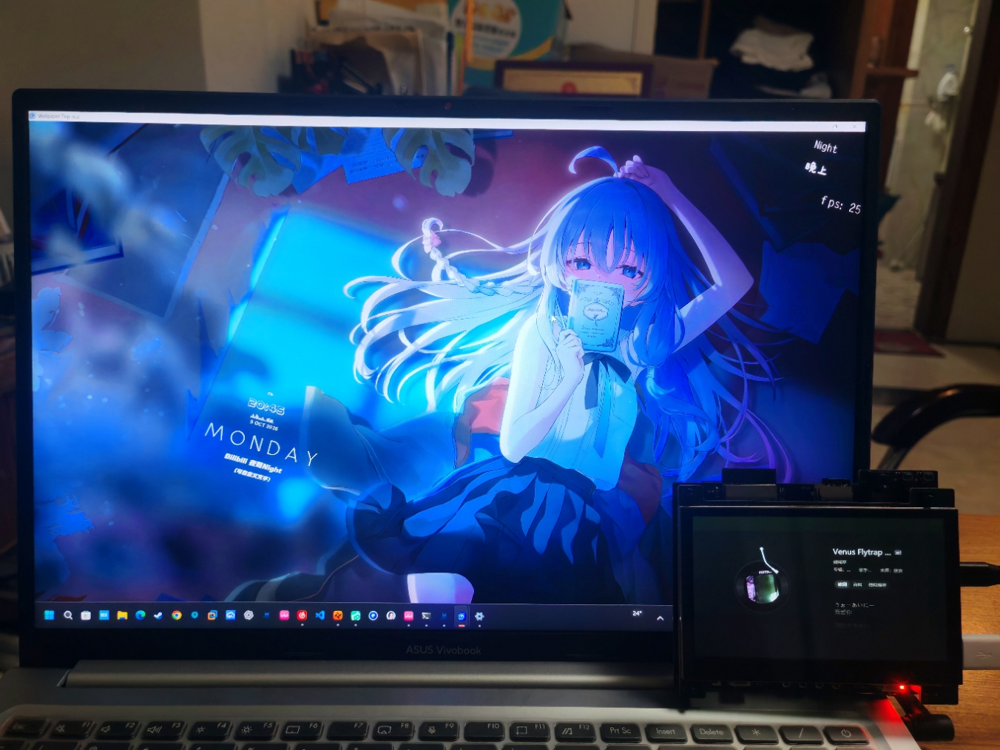
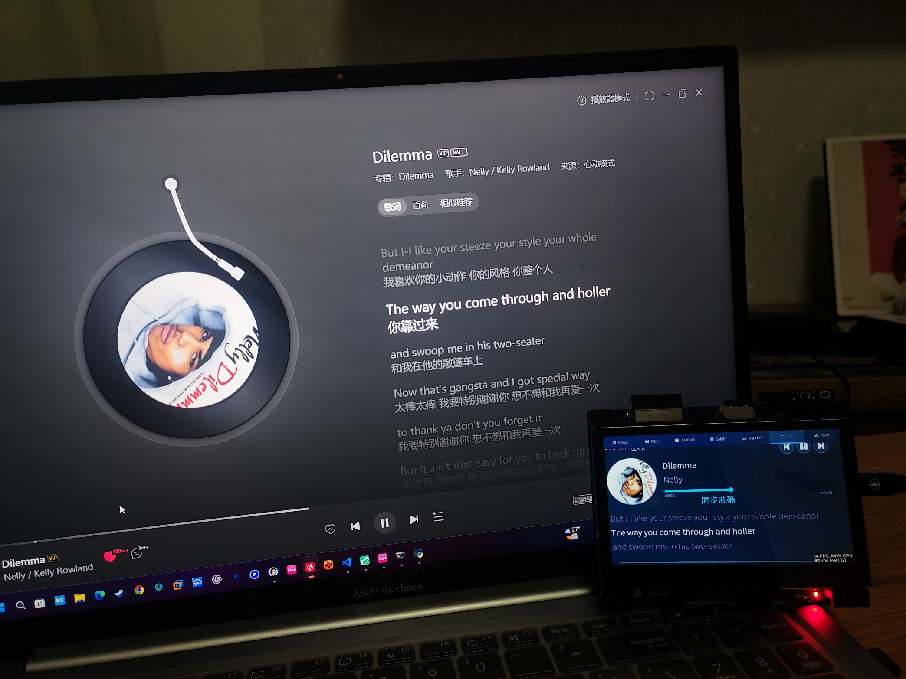
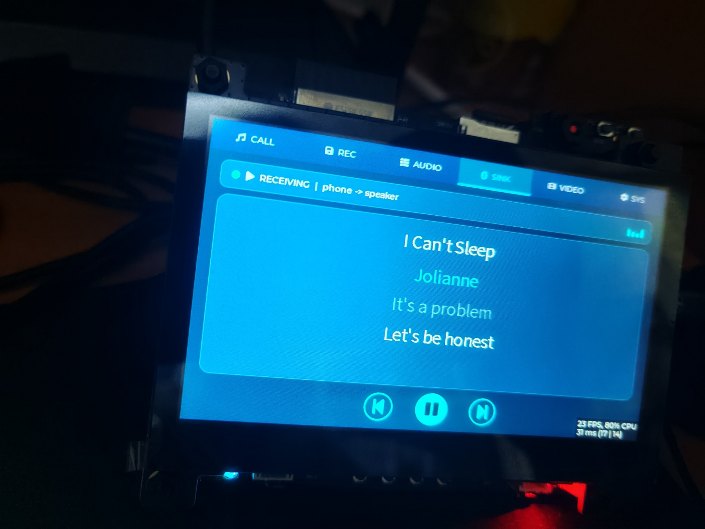
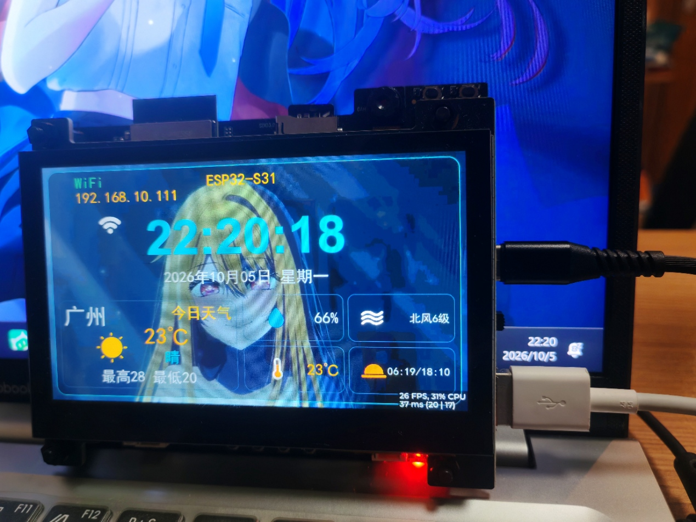

<div align="center">

# 基于 ESP32-S31-Korvo-1 的多功能智能音箱

**基于 ESP32-S31-Korvo-1 的多功能智能音箱固件：蓝牙音箱 / PC 音乐副屏 / 局域网对讲 / 录音回放 / 音乐视频播放 / WiFi-OTA / USB 扩展屏**
<br>
**不只是代码，更是一套 AI Agent 可读规范 → 写代码 → 烧录 → 抓日志 → 反复验证的智能开发闭环**

[](https://github.com/espressif/esp-idf)
[](https://www.espressif.com/en/products/socs/esp32-s3)
[](https://docs.espressif.com/projects/esp-bsp/en/latest/)
[](LICENSE)
[](https://en.cppreference.com/w/c)
[](https://www.freertos.org/)


-0078D4?logo=windows&logoColor=white)

</div>

---

## 📸 功能展示

<div align="center">

<table>
  <tr>
    <th width="50%">🔌 USB 扩展屏（Windows 认作真显示器，SET 键一键切换）</th>
    <th width="50%">🖥 PC NOW 音乐副屏（局域网推送封面 / 歌词 / 进度 / 媒体控制）</th>
  </tr>
  <tr>
    <td></td>
    <td></td>
  </tr>
  <tr>
    <th>🔵 蓝牙音箱（A2DP Sink，手机推歌 + 实时歌词）</th>
    <th>⛅ 天气时钟（SNTP 校时 + 和风天气实时仪表盘）</th>
  </tr>
  <tr>
    <td></td>
    <td></td>
  </tr>
</table>

</div>

---

## 📡 这是什么

一台 ESP32-S31 设备 = **蓝牙音箱 + PC 歌词副屏 + 局域网对讲机 + 录音笔 + 音视频播放器**，主界面 7 个 Tab：

| Tab | 功能 | 说明 |
|---|---|---|
| 🎙 **CALL** | 局域网实时对讲 | UDP 50000/50001 全双工语音，端到端 ≤100 ms（16 kHz/16 bit/mono） |
| 💾 **REC** | 本地录音 | 一键开录 → 存 SD 卡 WAV → FILES 页回放 |
| 🎵 **AUDIO** | 音乐播放中心 | SD 卡音乐（esp_player 硬解）；顶部切换 LOCAL 板载扬声器 / BT PUSH 蓝牙耳机推流 |
| 🔵 **SINK** | 蓝牙音箱 | A2DP Sink：手机推歌到本机播放，AVRCP 取歌名/进度显示 |
| 🎬 **VIDEO** | 视频播放 | 播放 SD 卡 MJPEG AVI，硬件 JPEG 解码 + PPA 缩放，全屏 800×480 |
| 🖥 **PC** | PC 音乐副屏 | 局域网接收 PC"正在播放"（网易云等）：旋转封面 + 三行滚动歌词（1.25 s 提前量补偿）+ 媒体控制键 |
| ⚙ **SYS** | 系统入口 | RGB 灯 / WiFi / 蓝牙信息 / OTA 升级等监视与设置卡 |

系统级能力：

| 能力 | 说明 |
|---|---|
| 🔄 **WiFi OTA** | 设备端 `ota_service` + LVGL 升级覆盖层，A/B 双槽轮替（ota_0 ⇄ ota_1），见 [`docs/项目规划/WiFi_OTA_烧录验收与使用流程.md`](docs/项目规划/WiFi_OTA_烧录验收与使用流程.md) |
| 🖥 **USB 扩展屏**（uext） | 另一套独立固件：本机变 Windows 的 800×480 USB 副屏（TinyUSB HS 收 JPEG → 硬解直写屏），主固件内**SET 键一键切换**，详见下文 |
| ⛅ **下拉仪表盘** | SNTP 校时 + 和风天气壁纸实时刷新 |
| 🔊 **音频仲裁** | `audio_service` 命令队列模型，UI 不直接碰 codec；播放/录音/对讲互斥调度 |

---

## 🔀 双固件架构（主固件 ⇄ 副屏固件）

```
                    ┌─────────────────────────────────────────┐
   16 MB Flash      │  ota_0(5M) ⇄ ota_1(5M)   uext(ota_2)    │
                    │   主固件 A/B OTA 轮替     USB 副屏固件    │
                    └─────────────────────────────────────────┘
   SET 键单击（主固件）→ 倒计时确认卡 → 重启进副屏
   SET 键单击（副屏）  → 回写引导标志  → 重启回主固件
```

- **主固件**（本仓库源码）：LVGL 全功能界面，OTA 只在 ota_0/ota_1 间轮替，**永不覆盖 uext 槽**（`ota_service.c: ota_pick_update_slot()` 显式锁槽，该补丁勿删）。
- **副屏固件**（预编译包在本仓库 `firmware/uext_screen/`）：源码为独立 IDF 工程（不在本仓库），USB Type-A 口直连 PC，Windows 端装 Espressif 官方签名 IDD 驱动后即成扩展显示器。画质参数：JPEG 质量 9 / 单帧上限 450 KB。
- ⚠️ 副屏固件**只能定点烧写 `0xA20000`**，对它跑 `idf.py flash` 会覆盖主固件。

---

## 🔄 WiFi OTA 升级（A/B 双槽，已实弹验收）

**零新增端口**：控制面复用 UDP 50003（link_manager），数据面复用 TCP 50005（pc_host 内置 HTTP），
设备作 **HTTP 客户端主动拉取**（无需 PC 能直连设备）。

```
PC: pc_host「固件升级」页                     设备: ota_service（middleware/network/）
 ① 选 bin → 解析 esp_app_desc_t                ⑥ 收 OFFER → 6 条校验链
    （版本/大小/SHA256）                          （离线/录音/会话/重复/待自证/槽容量）
 ② SemVer 比对 → OTA_OFFER(×3)  ──UDP 50003──▶ ⑦ 全过 → OTA_ACCEPT ◀──┐
 ③ 进度条 ◀──OTA_PROGRESS(×N)────────────────── ⑧ HTTP GET :50005/firmware.bin
 ④                                              边收边写**对侧槽**（32KB 攒块，
 ⑤ OTA_RESULT{ok} ◀───────────────────────────     每 256KB 段哈希落 nvs）
    esp_ota_end 段CRC校验 → set_boot_partition → OTA_RESULT{ok:1} → 1s 后重启
    新固件自证（WiFi 已连 且 link 在线，1s 周期条件驱动，~10s 转正）
    └─ 转正失败/窗口内断电 ⇒ bootloader 自动回滚旧槽（防砖）
```

- **PC 端**（[`pc_host/ui/pages/ota_page.py`](pc_host/ui/pages/ota_page.py)）：固件解析 / 版本比对 /
  进度与结果展示 / `--force`·截断·坏固件注入等验收开关；下载侧 600s 绝对超时 + 120s 活动超时。
- **设备端**（[`main/middleware/network/ota_service.c`](main/middleware/network/ota_service.c)）：
  A/B 双槽锁死 ota_0⇄ota_1（**永不触碰 uext 槽**）；flash IO 任务栈**强制内部 RAM**
  （IDF 冻结 cache 期间断言 SP，PSRAM 栈必 panic）；断点段哈希落 nvs（设备端写槽续传
  受 esp_ota API 限制已降级为全新下载）。
- **LVGL 浮层**（`ui/overlays/overlay_ota.c`）：升级期间全屏遮罩进度卡 + "请勿断电"警示，
  触摸不穿透；线程纪律 = 事件回调只赋值，刷新全在 `lv_timer`。
- **防砖四防线**：① `esp_ota_end` 镜像头 + 段 CRC；② 256KB 段摘要链 + 段数一致性；
  ③ 自证 + bootloader 自动回滚（已计划外实测：升级后断电 → 正确回退旧槽）；
  ④ 最坏情况 USB 全量重刷。

### 16 MB Flash 分布（partitions.csv V1.3，无 factory）

```
0x000000 ┌────────────────────────┐
         │ bootloader（隐含 ~36K） │
0x009000 ├────────────────────────┤
         │ nvs            24 KB   │  ← WiFi 凭据 / OTA 断点段哈希 / 壁纸索引
0x00F000 │ phy_init        4 KB   │
0x011000 │ otadata         8 KB   │  ← A/B 槽选择 + PENDING_VERIFY 回滚标记
0x020000 ├────────────────────────┤
         │ ota_0           5 MB   │  ← 主固件 A 槽
0x520000 │ ota_1           5 MB   │  ← 主固件 B 槽（OTA 写入对侧）
0xA20000 ├────────────────────────┤
         │ uext (ota_2)   2.875 MB│  ← USB 副屏固件专属，OTA 永不触碰（定点烧写）
0xD00000 ├────────────────────────┤
         │ storage (littlefs) 3 MB│  ← 壁纸池 / 素材（OTA 完全不碰）
0x1000000└────────────────────────┘
```

> OTA 只写 ota_0/ota_1 的**对侧**；`nvs`/`storage`/`uext` 一概不碰。
> 固件尺寸硬上限 = 5,242,880 B（超出设备回 `OTA_REJECT reason=space`）。
> 版本号 = `git describe` 烘焙进 `esp_app_desc_t`（**tag/提交后必须 `idf.py fullclean` 重建**，
> 否则增量构建不重跑 configure、版本串不更新）。

操作与逐项验收详见 [`docs/项目规划/WiFi_OTA_烧录验收与使用流程.md`](docs/项目规划/WiFi_OTA_烧录验收与使用流程.md)，
协议字段见 [`docs/项目规划/通信接口规范_ICD.md`](docs/项目规划/通信接口规范_ICD.md)。

---

## 🤖 为什么这仓库不只是固件

传统嵌入式开发：人写代码 → 人编译 → 人插线烧录 → 人开串口看日志 → 人判断对错 → 人改。

本仓库把这套流程**沉淀成 Agent 可执行的 Skill + 工程规范**：

```
Agent 读 docs/工程规范/01~11
        ↓
按模板写 middleware / ui 代码
        ↓
idf.py build                  （自动看 error:）
        ↓
idf.py -p COM9 flash          （自动看 Hash verified）
        ↓
python docs/_serial_capture.py（拉 RTS 复位，抓 12 s 日志）
        ↓
Agent 读日志：panic? 功能日志? 静默?
        ↓
不对就改代码，再走一遍
```

- **[`skills/esp-idf-closed-loop.md`](skills/esp-idf-closed-loop.md)** —— 闭环 SOP，Agent 每次开发前必读；
- **[`docs/工程规范/`](docs/工程规范/)** —— 分层架构、命名、模块模板、CheckList（01~11 + 附录）；
- **[`docs/项目规划/`](docs/项目规划/)** —— 需求文档、todolist、改动记录（§编号制）、各专项实施方案、ICD 接口规范。

### 🚫 红线（Agent 写代码时必须遵守）

- middleware 层不得 `#include "lvgl.h"`；
- UI 事件回调里不得直接建硬件任务、不得操作 codec / I2S / I2S 寄存器；
- 业务任务栈 ≥ 8192 字节；
- 新增 `.c` 必须注册 `main/CMakeLists.txt` 的 `SRCS`（放进对应领域分组）；
- `#include` 必须写从 `main/` 根开始的**完整路径**，禁止裸文件名（见 F25）；
- 高频音频链路（每 20 ms）禁止 `ESP_LOGI`。

---

## 🛠 硬件平台

| 项 | 值 |
|---|---|
| 开发板 | **ESP32-S31-Korvo-1 V1.1**（官方） |
| MCU | ESP32-S31 双核 RISC-V @ 320 MHz，512 KB SRAM |
| 存储 | 16 MB Flash + 16 MB Octal PSRAM @ 200 MHz |
| Codec | ES8389（I2C 0x20，**MCLK=GPIO42 未连 → `use_mclk=false`**） |
| 音频 I/O | 双 MEMS 麦 + 双 NS4150B 功放 |
| 屏幕 | 4.3" RGB 800×480 ST7262E43，**16-bit RGB565 总线**（GDMA 自动刷新）+ 电容触摸（GT1151） |
| USB | Type-A = USB 2.0 OTG HS（副屏数据口，对外 500 mA）；Type-C = 板载 UART 桥（烧录/日志口） |
| ESP-IDF | **v6.1.0**（`IDF_TARGET=esp32s31`） |
| 烧录端口 | COM9（以设备管理器为准） |
| 分区表 | nvs 24K / phy 4K / otadata 8K / **ota_0 5M / ota_1 5M** / **uext(ota_2) 2.875M** / **storage littlefs 3M**（无 factory，A/B OTA + 副屏槽） |
| 文件系统 | LittleFS（挂载点 `/littlefs`）；录音/音乐存 SD 卡 |

---

## 📁 目录结构

```
display_audio_photo/
├── main/
│   ├── app/main.c                # app_main() 初始化顺序 + SET 键事件分发
│   ├── middleware/               # 硬件业务，不 include LVGL
│   │   ├── audio/                # audio_service / record_service / udp_voice / session_manager
│   │   ├── bluetooth/            # bt_audio_service(A2DP Source) / bt_sink_service / bt_push_service / link_manager
│   │   ├── network/              # wifi_manager / pcnow_service / ota_service / net_time_service
│   │   └── system/               # button_service / led_service / fs_service / sdcard_service
│   ├── ui/                       # LVGL 界面（PageManager 栈式导航）
│   │   ├── ui_manager/           # page_manager 页面注册/切换/返回栈
│   │   ├── pages/                # page_splash / page_main / page_wifi / page_bluetooth
│   │   │                         #   page_system / page_rgb / page_wav_player
│   │   ├── tabs/                 # tab_call / tab_record / tab_audio / tab_btsink
│   │   │                         #   tab_video / tab_pcnow / tab_sys_entry
│   │   ├── overlays/             # overlay_manager / overlay_wallpaper / overlay_wp_particles
│   │   │                         #   overlay_ota(WiFi升级) / overlay_uext(副屏切换确认卡)
│   │   ├── common/               # ui_common（控件工厂）+ ui_theme.h（颜色/字体宏唯一来源）
│   │   └── assets/               # fonts/ bin 字体 + icons/ 图标（生成物，勿手改）
│   └── 3rd/ringbuf/              # 第三方纯 C 环形缓冲
├── pc_host/                      # PySide6 PC 上位机（对讲 + 录音 + PC NOW 推流；入口 start_all.bat）
├── tools/pc_now_agent/           # C# 轻量替代：SMTC 抓取 → UDP 推流到设备（与 pc_host 二选一）
├── firmware/uext_screen/         # ★ USB 副屏固件预编译烧录包（bin + Windows 驱动 + 烧录说明）
├── docs/
│   ├── 工程规范/                 # Agent 写代码前必读（01~11 + 附录）
│   ├── 项目规划/                 # 需求 / todolist / 改动记录 / ICD / 各专项方案
│   └── _serial_capture.py        # 替代 idf.py monitor
├── skills/
│   └── esp-idf-closed-loop.md   # 闭环 SOP：build→flash→抓日志→定位→再改
├── littlefs_content/             # LittleFS 素材（壁纸 / 开机提示音）
├── components/                   # 本地组件（esp_littlefs / cjson）
├── partitions.csv                # V1.3：ota_0/ota_1 各 5M + uext(ota_2) + storage 3M
└── CMakeLists.txt
```

> 分层规则、各目录职责与归位判断见 [`docs/工程规范/01_工程分层架构.md`](docs/工程规范/01_工程分层架构.md)。

---

## 🚀 快速开始（主固件）

### 1. 安装 ESP-IDF（用 EIM 一键管理）

**EIM（Espressif IDF Manager）** 是乐鑫官方的 IDF 版本管理器，图形界面，免去手动装 Python / 工具链。

- 下载：[https://idf.espressif.com/](https://idf.espressif.com/)
- 本仓库用 **v6.1.0**，安装时在 EIM 里选 v6.1.x 即可

安装完后 EIM 会自动配好 Python venv、交叉编译工具链、OpenOCD、CMake。

### 2. 打开 IDF 终端

双击本仓库根目录的 **`IDF_v6.1_Powershell.lnk`**（或手动执行 PowerShell profile）：

```powershell
. 'C:\Espressif\tools\Microsoft.v6.1.PowerShell_profile.ps1'
cd <本仓库根>
```

成功标志：看到 `IDF_PATH: C:\esp\v6.1\esp-idf` 等。

### 3. 编译 + 烧录（COM9）

```powershell
idf.py build
idf.py -p COM9 flash
idf.py -p COM9 storage-flash     # 首次烧录 / littlefs 素材变更后，刷 storage 分区
```

> ⚠️ 改过 `partitions.csv` 后必须 `fullclean` 重编 + 重跑 `storage-flash`。

### 4. 看日志

非交互终端跑 `idf.py monitor` 会报 TTY 错误，用本仓库脚本：

```powershell
& "C:\Espressif\tools\python\v6.1\venv\Scripts\python.exe" docs\_serial_capture.py
```

自动拉 RTS 复位，读 12 秒启动日志。

---

## 🖥 USB 副屏固件烧录（uext）

**三种场景对号入座：**

### A. 只想用副屏（不碰源码）—— 直接用预编译包

仓库自带 [`firmware/uext_screen/`](firmware/uext_screen/)（含 `uext_screen.bin` + Windows 已签名驱动 + 详细说明）：

1. 主固件先按上面流程烧好（分区表必须带 uext 槽）；
2. IDF 终端定点烧写（COM 口以设备管理器为准）：
   ```powershell
   python -m esptool -p COM9 write-flash 0xA20000 firmware/uext_screen/uext_screen.bin
   ```
3. 主界面**单击 SET 键 → 倒计时确认卡点确认**，重启进入副屏模式；
4. PC 端双击 `firmware/uext_screen/xfz1986_usb_graphic_250224_rc_sign.exe` 装官方签名 IDD 驱动；
5. USB Type-A 口连 PC → 设备管理器出现 `USB\VID_303A&PID_2986` 复合设备 → `Win+P` 设为"扩展这些显示器"→ 出现 800×480 扩展屏；
6. 触摸可用，需在 Windows"平板设置"里做屏幕映射；
7. **切回主固件：副屏模式下单击 SET 键**，自动重启回主固件（无需重烧）。

### B. 想改副屏固件源码

源码仓库：**[xkk6663/uext_screen](https://github.com/xkk6663/uext_screen)**（独立 IDF 工程，含 7 个离线 vendor 组件；架构与坑见 [`docs/项目规划/USB副屏集成技术方案.md`](docs/项目规划/USB副屏集成技术方案.md)）。只 `idf.py build`，**绝不 `idf.py flash`**，产物定点烧 `0xA20000`。

### C. 画质调优

改 `uext_screen` 工程的 `CONFIG_USB_EXTEND_SCREEN_JPEG_QUALITY`（当前 9，上限 10）与 `CONFIG_USB_EXTEND_SCREEN_FRAME_LIMIT_B`（当前 450000）。注意：落屏格式是 RGB565（16-bit 屏总线），**没有 RGB888 可开**——JPEG 质量与帧上限是仅有的两个真实画质旋钮。

---

## 🖥 PC 端（PC NOW 副屏推流 / 对讲）

设备 PC Tab 与 CALL Tab 需要局域网内一台 PC 配合，二选一：

| 端 | 技术 | 说明 |
|---|---|---|
| [`pc_host/`](pc_host/) | PySide6 GUI | **全功能**：对讲 / 录音 / PC NOW 推流（网易云 debug 端口 9222 抓取播放态 → 歌词/封面/进度）/ **WiFi OTA 固件升级**。启动：桌面 `ESP32_Voice_Host.bat` 或 `pc_host/start_all.bat`（幂等） |
| [`tools/pc_now_agent/`](tools/pc_now_agent/) | C# 单体 | 轻量：Windows SMTC 直接抓"正在播放"推 UDP（OTA 命令行备用，**推荐用 pc_host 固件升级页**）。与 pc_host 的推流端口冲突，**同一时间只跑一个** |

协议细节见 [`docs/项目规划/通信接口规范_ICD.md`](docs/项目规划/通信接口规范_ICD.md)。

---

## 🧠 如何让 AI Agent 接管开发

1. 把本仓库喂给 Agent（豆包 / Claude / Cursor 等）；
2. 让 Agent 先 `Read skills/esp-idf-closed-loop.md`；
3. 再 `Read docs/工程规范/01~11`；
4. 给任务（例如"实现 wifi_manager.c 按 STA 模式连指定 SSID"）；
5. Agent 会自己：按模板写代码 → 注册 `SRCS` → build → flash → 抓日志 → 定位修复 → 在 `docs/项目规划/改动记录.md` 追加 §记录。

---

## ✅ 当前进度

- [x] M1 音频链路（ES8389 / I2S DMA / WAV 播放 / 本地录音）
- [x] UI 骨架（7 Tab + 开屏壁纸 + 上拉手势 + RGB / WiFi / System 监视卡）
- [x] Wi-Fi STA（扫描/连接/状态灯）+ SNTP + 和风天气仪表盘
- [x] M2 UDP 通话（link_manager + udp_voice + PC 端）
- [x] 阶段 A/B：SD 卡存储 + 音频/视频播放（AUDIO HUB / VIDEO tab，MJPEG 硬解）
- [x] 蓝牙双模式：A2DP Source 本地推流（AUDIO 页切换）+ A2DP Sink 蓝牙音箱（SINK tab）
- [x] PC NOW 音乐副屏（封面旋转 + 全量 LRC 歌词 1.25s 补偿 + 媒体键），pc_host / pc_now_agent 双端
- [x] M6 OTA：A/B 双槽 WiFi 升级（ota_service + LVGL 覆盖层 + PC 端烧录 agent）——**已实弹验收**（v1.0→v1.4 五连升 + 断电回滚实测，2026-10-08）
- [x] USB 扩展屏（uext 双固件架构：SET 键双向切换 + 预编译烧录包 `firmware/uext_screen/`）
- [ ] M3 TCP 录音远端化 + M4 多任务调度深化
- [ ] 小智 AI 对话接入（方案已定稿：[`docs/项目规划/小智AI对话接入实施方案.md`](docs/项目规划/小智AI对话接入实施方案.md)，未开工）

详见 [`docs/项目规划/todolist.md`](docs/项目规划/todolist.md)。

---

<div align="center">

**License**：Apache-2.0（沿用 esp-bsp） · **Maintainer**：xkk6663

</div>
