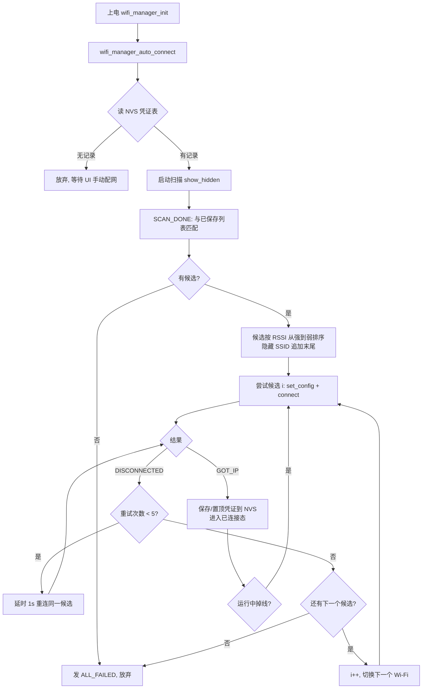

# Wi-Fi 多网络记忆与上电自动连接改造方案

> 适用仓库：[Harness_ESP32S31](https://github.com/xkk6663/Harness_ESP32S31)
> 目标芯片：ESP32-S31（ESP32_S31_KORVO_1 BSP）
> 改造模块：`main/middleware/wifi_manager.c/.h`、`main/app/main.c`、`main/ui/page_wifi.c`
> 编写日期：2026-09-16

---

## 1. 需求与现状

### 1.1 需求

1. 设备一旦联网成功（拿到 IP），把当前 Wi-Fi 的 **SSID + 密钥写入 NVS**；
2. NVS 支持**记忆多个 Wi-Fi**（最多 5 个）；
3. 下次上电**优先读取 NVS**，自动尝试连接已保存的 Wi-Fi，无需手动操作；
4. 每个 Wi-Fi **连接失败重试 5 次后放弃**，自动切换下一个已保存 Wi-Fi；全部失败则放弃，回到等待手动配网状态。

### 1.2 现状盘点（基于当前源码）

| 现状 | 说明 |
|---|---|
| `wifi_manager_init()` | 只做 nvs/netif/event/wifi_start，日志明确写 `no auto-connect`，**上电不自动连** |
| `wifi_manager_connect(ssid, pass)` | UI 手动连接，**密码不落盘**，重启即丢失 |
| `WIFI_MAX_RETRY 5`、`s_retry_num` | **已定义但从未使用**，DISCONNECTED 事件里没有任何重试逻辑 |
| DISCONNECTED 事件 | 仅置标志位 + 通知 UI，不重连、不切换 |
| GOT_IP 事件 | 置 connected + 通知，**不保存凭证** |
| NVS | 仅 `nvs_flash_init()`，未用 NVS 存任何业务数据 |
| UI（`page_wifi.c`） | 扫描 → 列表 → 选 AP → 键盘输密码 → connect，流程完整，本次保留 |

> 结论：底层扫描/连接/事件框架已具备，本次改造是在其上增加 **NVS 凭证存储层** + **自动连接状态机** + **重试/切换逻辑**，不改动 UI 主流程。

---

## 2. 总体设计

### 2.1 NVS 存储结构

NVS 是键值（key-value）存储，用一个 blob 键 `creds` 存整张凭证表（单条 < 1 KB，远小于 NVS blob 上限）：

- namespace：`wifi_cfg`
- key：`creds`
- value：`wifi_store_t` 结构体

```c
#define WIFI_SAVED_MAX    5        /* 最多记忆 5 个 Wi-Fi */
#define WIFI_PASS_LEN_MAX 64       /* WPA2 密钥最大 64 字符 */

typedef struct {
    char ssid[33];                /* WIFI_SSID_LEN_MAX(32) + 1 */
    char password[65];            /* 64 + 1，开放网络为空串 */
} wifi_cred_t;

typedef struct {
    uint32_t magic;               /* 0x57494649 'WIFI'，校验 blob 合法性 */
    uint16_t version;             /* 结构版本号，当前 1 */
    uint16_t count;               /* 实际保存条数 */
    wifi_cred_t creds[WIFI_SAVED_MAX];
} wifi_store_t;
```

**写入策略（最近成功优先 LRU）：**
- 相同 SSID 已存在 → 更新密码并**移动到队首**；
- 新 SSID → 插入队首；
- 已满 5 个 → 淘汰队尾（最久未成功连接的）。

> NVS 分区当前为 24 KB（`partitions.csv` 中 `nvs, data, nvs, 0x9000, 0x6000`），凭证表不足 1 KB，**无需调整分区表**。

### 2.2 自动连接状态机



**关键规则：**
- 自动连接先扫描，把扫描到的 AP 与已保存凭证匹配，**按信号强度（RSSI）从强到弱**排序后逐个尝试；扫描不到但已保存的（可能是隐藏 SSID）追加到末尾；
- 每个候选最多发起 **5 次**连接（收到 5 次 DISCONNECTED 且未拿到 IP 即判定失败）；
- 5 次失败自动切换下一个候选；全部失败发 `WIFI_EVT_ALL_FAILED`；
- 手动连接（UI 选 AP 输密码）复用同一套"候选 + 重试"逻辑，只是候选数固定为 1；
- 连接成功后运行中掉线，自动重连当前 Wi-Fi（同样走 5 次重试）。

### 2.3 重试时序

DISCONNECTED 事件运行在 `esp_event` 任务上，不能长时间阻塞。用一次性 `esp_timer`（1 秒）延时后再调 `esp_wifi_connect()`，避免认证风暴，也不阻塞事件循环。

---

## 3. 详细改造步骤

### 步骤 1：改造 `main/middleware/wifi_manager.h`

新增凭证宏、`WIFI_EVT_ALL_FAILED` 事件、三个对外接口：

```c
/**
 * @file wifi_manager.h
 * @brief 中间层：Wi-Fi STA 服务（NVS 多网络记忆 / 上电自动连接 / 扫描 / 手动连接）
 */

#pragma once

#include <stdbool.h>
#include <stdint.h>
#include "esp_err.h"

#ifdef __cplusplus
extern "C" {
#endif

#define WIFI_SSID_LEN_MAX 32
#define WIFI_PASS_LEN_MAX 64
#define WIFI_SAVED_MAX    5        /* NVS 最多记忆的 Wi-Fi 数量 */
#define WIFI_MAX_RETRY    5        /* 单个 Wi-Fi 连接失败重试次数 */

typedef enum {
    WIFI_EVT_DISCONNECTED = 0,
    WIFI_EVT_CONNECTING,
    WIFI_EVT_CONNECTED,
    WIFI_EVT_GOT_IP,
    WIFI_EVT_SCAN_DONE,
    WIFI_EVT_ALL_FAILED,          /* 新增：所有已保存 Wi-Fi 各重试 5 次后仍失败 */
} wifi_evt_t;

typedef struct {
    char    ssid[WIFI_SSID_LEN_MAX + 1];
    int8_t  rssi;
    uint8_t open;   /* 1 = open network (no password) */
} wifi_ap_info_t;

typedef void (*wifi_evt_cb_t)(wifi_evt_t evt, const char *info);

/**
 * @brief 初始化 Wi-Fi 底层（nvs/netif/event/wifi_start），不自动连接
 */
void wifi_manager_init(void);

/**
 * @brief 上电自动连接：读 NVS 已保存 Wi-Fi，扫描后按信号强度依次尝试，
 *        每个重试 WIFI_MAX_RETRY 次；无保存记录时直接返回
 */
void wifi_manager_auto_connect(void);

void wifi_manager_set_evt_cb(wifi_evt_cb_t cb);
void wifi_manager_set_sys_cb(wifi_evt_cb_t cb);

void wifi_manager_start_scan(void);
int  wifi_manager_get_scan_results(wifi_ap_info_t *out, int max);

/**
 * @brief 手动连接指定 SSID/密钥（成功后自动写入 NVS）
 */
void wifi_manager_connect(const char *ssid, const char *pass);

bool wifi_manager_is_connected(void);
void wifi_manager_get_ip(char *buf, int len);

/* ---- NVS 凭证管理（可选，供 UI"已保存网络"页面使用）---- */

/** @brief NVS 中已保存的 Wi-Fi 数量 */
int  wifi_manager_get_saved_count(void);

/** @brief 删除指定 SSID 的已保存凭证 */
esp_err_t wifi_manager_forget(const char *ssid);

#ifdef __cplusplus
}
#endif
```

### 步骤 2：改造 `main/middleware/wifi_manager.c`（完整可替换）

```c
/*
 * SPDX-FileCopyrightText: 2026 Espressif Systems (Shanghai) CO LTD
 *
 * SPDX-License-Identifier: Apache-2.0
 */

#include "wifi_manager.h"
#include "esp_log.h"
#include "esp_event.h"
#include "esp_netif.h"
#include "esp_wifi.h"
#include "esp_timer.h"
#include "nvs_flash.h"
#include "nvs.h"
#include "freertos/FreeRTOS.h"
#include "freertos/task.h"
#include <string.h>

static const char *TAG = "WIFI_MGR";

#define MAX_AP                  16
#define WIFI_NVS_NAMESPACE      "wifi_cfg"
#define WIFI_NVS_KEY            "creds"
#define WIFI_STORE_MAGIC        0x57494649u   /* 'WIFI' */
#define WIFI_STORE_VERSION      1
#define WIFI_RECONNECT_DELAY_MS 1000

/* ================= NVS 凭证存储层 ================= */

typedef struct {
    char ssid[WIFI_SSID_LEN_MAX + 1];
    char password[WIFI_PASS_LEN_MAX + 1];
} wifi_cred_t;

typedef struct {
    uint32_t magic;
    uint16_t version;
    uint16_t count;
    wifi_cred_t creds[WIFI_SAVED_MAX];
} wifi_store_t;

static esp_err_t store_load(wifi_store_t *store)
{
    nvs_handle_t h;
    esp_err_t err = nvs_open(WIFI_NVS_NAMESPACE, NVS_READONLY, &h);
    if (err != ESP_OK) {
        return err;
    }
    size_t len = sizeof(*store);
    err = nvs_get_blob(h, WIFI_NVS_KEY, store, &len);
    nvs_close(h);
    if (err != ESP_OK) {
        return err;
    }
    if (store->magic != WIFI_STORE_MAGIC ||
        store->version != WIFI_STORE_VERSION ||
        store->count > WIFI_SAVED_MAX) {
        return ESP_ERR_INVALID_VERSION;
    }
    return ESP_OK;
}

static esp_err_t store_commit(const wifi_store_t *store)
{
    nvs_handle_t h;
    esp_err_t err = nvs_open(WIFI_NVS_NAMESPACE, NVS_READWRITE, &h);
    if (err != ESP_OK) {
        return err;
    }
    err = nvs_set_blob(h, WIFI_NVS_KEY, store, sizeof(*store));
    if (err == ESP_OK) {
        err = nvs_commit(h);
    }
    nvs_close(h);
    return err;
}

/* 相同 SSID 更新密码并置顶；新 SSID 插队首；满了淘汰队尾 */
static void store_upsert(wifi_store_t *store, const char *ssid, const char *pass)
{
    wifi_cred_t node;
    memset(&node, 0, sizeof(node));
    strncpy(node.ssid, ssid, WIFI_SSID_LEN_MAX);
    if (pass) {
        strncpy(node.password, pass, WIFI_PASS_LEN_MAX);
    }

    /* 已存在则先从旧位置删除 */
    for (int i = 0; i < store->count; i++) {
        if (strcmp(store->creds[i].ssid, ssid) == 0) {
            memmove(&store->creds[i], &store->creds[i + 1],
                    (store->count - i - 1) * sizeof(wifi_cred_t));
            store->count--;
            break;
        }
    }

    /* 整体后移腾出 0 号位；已满则丢弃队尾 */
    int move = (store->count < WIFI_SAVED_MAX) ? store->count : (WIFI_SAVED_MAX - 1);
    memmove(&store->creds[1], &store->creds[0], move * sizeof(wifi_cred_t));
    store->creds[0] = node;
    if (store->count < WIFI_SAVED_MAX) {
        store->count++;
    }
    store->magic = WIFI_STORE_MAGIC;
    store->version = WIFI_STORE_VERSION;
}

/* 连接成功后保存当前凭证 */
static void save_connected_cred(void)
{
    wifi_config_t cur = {0};
    if (esp_wifi_get_config(WIFI_IF_STA, &cur) != ESP_OK) {
        return;
    }
    wifi_store_t store;
    memset(&store, 0, sizeof(store));
    if (store_load(&store) != ESP_OK) {
        store.count = 0;   /* 首次使用，空表 */
    }
    store_upsert(&store, (const char *)cur.sta.ssid, (const char *)cur.sta.password);
    esp_err_t err = store_commit(&store);
    ESP_LOGI(TAG, "saved \"%s\" to NVS (%s), total=%d",
             cur.sta.ssid, esp_err_to_name(err), store.count);
}

/* ================= 自动连接状态机 ================= */

typedef enum {
    PHASE_IDLE = 0,
    PHASE_SCANNING,   /* 自动连接：等待扫描结果 */
    PHASE_TRYING,     /* 正在尝试某个候选 */
} connect_phase_t;

static wifi_evt_cb_t s_evt_cb;
static wifi_evt_cb_t s_sys_cb;
static bool s_connected;
static char s_ip[16];

static wifi_ap_info_t s_ap_list[MAX_AP];
static int  s_ap_count;

static connect_phase_t s_phase = PHASE_IDLE;
static bool s_have_active;                 /* 当前候选表有效（尝试中/已连接） */
static wifi_cred_t s_candidates[WIFI_SAVED_MAX];
static int  s_cand_count;
static int  s_cand_idx;
static int  s_retry_num;
static char s_cur_ssid[WIFI_SSID_LEN_MAX + 1];
static wifi_store_t s_pending_store;       /* 自动连接扫描期间暂存凭证表 */
static esp_timer_handle_t s_reconnect_timer;

static void notify(wifi_evt_t evt, const char *info)
{
    ESP_LOGI(TAG, "evt=%d info=%s", evt, info ? info : "-");
    if (s_sys_cb) {
        s_sys_cb(evt, info);
    }
    if (s_evt_cb) {
        s_evt_cb(evt, info);
    }
}

/* 扫描结果与已保存凭证匹配：扫描到的按 RSSI 降序，隐藏 SSID 追加末尾 */
static void build_candidates(void)
{
    s_cand_count = 0;
    bool matched[WIFI_SAVED_MAX] = {0};

    /* 第一轮：每次从扫描结果中挑"未匹配且信号最强"的 AP */
    for (;;) {
        int best_ap = -1, best_cred = -1;
        for (int a = 0; a < s_ap_count; a++) {
            for (int c = 0; c < s_pending_store.count; c++) {
                if (matched[c]) {
                    continue;
                }
                if (strcmp(s_ap_list[a].ssid, s_pending_store.creds[c].ssid) != 0) {
                    continue;
                }
                if (best_ap < 0 || s_ap_list[a].rssi > s_ap_list[best_ap].rssi) {
                    best_ap = a;
                    best_cred = c;
                }
            }
        }
        if (best_ap < 0) {
            break;
        }
        s_candidates[s_cand_count++] = s_pending_store.creds[best_cred];
        matched[best_cred] = true;
    }

    /* 第二轮：扫描不到的已保存 Wi-Fi（隐藏 SSID）按存储顺序追加 */
    for (int c = 0; c < s_pending_store.count; c++) {
        if (!matched[c] && s_cand_count < WIFI_SAVED_MAX) {
            s_candidates[s_cand_count++] = s_pending_store.creds[c];
        }
    }
}

static void apply_candidate(const wifi_cred_t *cred)
{
    wifi_config_t sta_cfg = {0};
    strncpy((char *)sta_cfg.sta.ssid, cred->ssid, sizeof(sta_cfg.sta.ssid) - 1);
    if (cred->password[0]) {
        strncpy((char *)sta_cfg.sta.password, cred->password,
                sizeof(sta_cfg.sta.password) - 1);
        sta_cfg.sta.threshold.authmode = WIFI_AUTH_WPA2_PSK;
    } else {
        sta_cfg.sta.threshold.authmode = WIFI_AUTH_OPEN;
    }
    ESP_ERROR_CHECK(esp_wifi_set_config(WIFI_IF_STA, &sta_cfg));

    strncpy(s_cur_ssid, cred->ssid, sizeof(s_cur_ssid) - 1);
    s_retry_num = 0;
    s_phase = PHASE_TRYING;
    s_have_active = true;
    notify(WIFI_EVT_CONNECTING, cred->ssid);
    esp_wifi_connect();
    ESP_LOGI(TAG, "connecting to \"%s\"", cred->ssid);
}

static void reconnect_timer_cb(void *arg)
{
    (void)arg;
    if (s_phase == PHASE_TRYING) {
        s_retry_num++;
        ESP_LOGW(TAG, "retry \"%s\" (%d/%d)", s_cur_ssid,
                 s_retry_num + 1, WIFI_MAX_RETRY);
        esp_wifi_connect();
    }
}

/* 当前候选 5 次失败后：切换下一个，或全部放弃 */
static void next_candidate_or_giveup(void)
{
    s_cand_idx++;
    if (s_cand_idx < s_cand_count) {
        ESP_LOGW(TAG, "switch to next saved Wi-Fi: \"%s\"",
                 s_candidates[s_cand_idx].ssid);
        apply_candidate(&s_candidates[s_cand_idx]);
    } else {
        s_phase = PHASE_IDLE;
        s_have_active = false;
        s_connected = false;
        ESP_LOGE(TAG, "all saved Wi-Fi failed after retries, give up");
        notify(WIFI_EVT_ALL_FAILED, NULL);
    }
}

static void wifi_event_handler(void *arg, esp_event_base_t base,
                               int32_t event_id, void *event_data)
{
    if (base == WIFI_EVENT && event_id == WIFI_EVENT_STA_START) {
        ESP_LOGI(TAG, "STA started");
    } else if (base == WIFI_EVENT && event_id == WIFI_EVENT_STA_DISCONNECTED) {
        wifi_event_sta_disconnected_t *d =
            (wifi_event_sta_disconnected_t *)event_data;
        s_connected = false;
        ESP_LOGW(TAG, "disconnected from \"%s\", reason=%d", s_cur_ssid, d->reason);

        if (s_phase == PHASE_TRYING) {
            /* 连接阶段失败：计数重试 */
            if (s_retry_num + 1 < WIFI_MAX_RETRY) {
                esp_timer_stop(s_reconnect_timer);
                esp_timer_start_once(s_reconnect_timer,
                                     WIFI_RECONNECT_DELAY_MS * 1000);
            } else {
                ESP_LOGW(TAG, "\"%s\" failed after %d attempts",
                         s_cur_ssid, WIFI_MAX_RETRY);
                next_candidate_or_giveup();
            }
        } else if (s_have_active && s_cand_count > 0) {
            /* 已连接后运行中掉线：重连当前 Wi-Fi（重新计数） */
            ESP_LOGW(TAG, "link lost, reconnect \"%s\"", s_cur_ssid);
            apply_candidate(&s_candidates[s_cand_idx]);
        } else {
            notify(WIFI_EVT_DISCONNECTED, NULL);
        }
    } else if (base == WIFI_EVENT && event_id == WIFI_EVENT_SCAN_DONE) {
        s_ap_count = 0;
        uint16_t num = 0;
        if (esp_wifi_scan_get_ap_num(&num) == ESP_OK && num > 0) {
            wifi_ap_record_t *rec = calloc(num, sizeof(wifi_ap_record_t));
            if (rec) {
                uint16_t got = num;
                if (esp_wifi_scan_get_ap_records(&got, rec) == ESP_OK) {
                    for (uint16_t i = 0; i < got && s_ap_count < MAX_AP; i++) {
                        memset(&s_ap_list[s_ap_count], 0, sizeof(wifi_ap_info_t));
                        strncpy(s_ap_list[s_ap_count].ssid,
                                (const char *)rec[i].ssid, WIFI_SSID_LEN_MAX);
                        s_ap_list[s_ap_count].rssi = rec[i].rssi;
                        s_ap_list[s_ap_count].open =
                            (rec[i].authmode == WIFI_AUTH_OPEN) ? 1 : 0;
                        s_ap_count++;
                    }
                }
                free(rec);
            }
        }
        ESP_LOGI(TAG, "scan done: %d APs", s_ap_count);

        if (s_phase == PHASE_SCANNING) {
            /* 上电自动连接流程：匹配候选并开始尝试 */
            build_candidates();
            if (s_cand_count > 0) {
                s_cand_idx = 0;
                apply_candidate(&s_candidates[0]);
            } else {
                s_phase = PHASE_IDLE;
                ESP_LOGW(TAG, "no saved Wi-Fi visible, give up");
                notify(WIFI_EVT_ALL_FAILED, NULL);
            }
        } else {
            /* UI 手动扫描 */
            notify(WIFI_EVT_SCAN_DONE, NULL);
        }
    } else if (base == IP_EVENT && event_id == IP_EVENT_STA_GOT_IP) {
        ip_event_got_ip_t *event = (ip_event_got_ip_t *)event_data;
        esp_ip4addr_ntoa(&event->ip_info.ip, s_ip, sizeof(s_ip));
        s_connected = true;
        s_phase = PHASE_IDLE;
        s_have_active = true;
        esp_timer_stop(s_reconnect_timer);
        ESP_LOGI(TAG, "got ip: %s", s_ip);

        /* 联网成功：保存/置顶凭证到 NVS */
        save_connected_cred();

        notify(WIFI_EVT_GOT_IP, s_ip);
    }
}

void wifi_manager_init(void)
{
    esp_err_t ret = nvs_flash_init();
    if (ret == ESP_ERR_NVS_NO_FREE_PAGES || ret == ESP_ERR_NVS_NEW_VERSION_FOUND) {
        ESP_ERROR_CHECK(nvs_flash_erase());
        ESP_ERROR_CHECK(nvs_flash_init());
    }

    ESP_ERROR_CHECK(esp_netif_init());
    ESP_ERROR_CHECK(esp_event_loop_create_default());
    esp_netif_create_default_wifi_sta();

    wifi_init_config_t cfg = WIFI_INIT_CONFIG_DEFAULT();
    ESP_ERROR_CHECK(esp_wifi_init(&cfg));

    ESP_ERROR_CHECK(esp_event_handler_register(WIFI_EVENT, ESP_EVENT_ANY_ID,
                                               &wifi_event_handler, NULL));
    ESP_ERROR_CHECK(esp_event_handler_register(IP_EVENT, IP_EVENT_STA_GOT_IP,
                                               &wifi_event_handler, NULL));

    /* 重连定时器（单次，1s） */
    esp_timer_create_args_t targ = {
        .callback = reconnect_timer_cb,
        .name = "wifi_rc",
    };
    ESP_ERROR_CHECK(esp_timer_create(&targ, &s_reconnect_timer));

    ESP_ERROR_CHECK(esp_wifi_set_mode(WIFI_MODE_STA));
    ESP_ERROR_CHECK(esp_wifi_start());

    ESP_LOGI(TAG, "wifi STA init done");
}

void wifi_manager_auto_connect(void)
{
    memset(&s_pending_store, 0, sizeof(s_pending_store));
    if (store_load(&s_pending_store) != ESP_OK || s_pending_store.count == 0) {
        ESP_LOGI(TAG, "no saved Wi-Fi in NVS, skip auto-connect");
        return;
    }
    ESP_LOGI(TAG, "auto-connect: %d saved Wi-Fi, scanning...",
             s_pending_store.count);

    esp_timer_stop(s_reconnect_timer);
    s_phase = PHASE_SCANNING;
    wifi_scan_config_t scan_cfg = {0};
    scan_cfg.show_hidden = true;       /* 允许发现隐藏 SSID */
    scan_cfg.scan_type = WIFI_SCAN_TYPE_ACTIVE;
    esp_wifi_scan_start(&scan_cfg, false);
}

void wifi_manager_set_evt_cb(wifi_evt_cb_t cb) { s_evt_cb = cb; }
void wifi_manager_set_sys_cb(wifi_evt_cb_t cb) { s_sys_cb = cb; }

void wifi_manager_start_scan(void)
{
    ESP_LOGI(TAG, "manual scan start");
    s_phase = PHASE_IDLE;              /* 手动扫描不影响后续手动连接 */
    wifi_scan_config_t scan_cfg = {0};
    scan_cfg.show_hidden = false;
    scan_cfg.scan_type = WIFI_SCAN_TYPE_ACTIVE;
    esp_wifi_scan_start(&scan_cfg, false);
}

int wifi_manager_get_scan_results(wifi_ap_info_t *out, int max)
{
    int n = (s_ap_count < max) ? s_ap_count : max;
    memcpy(out, s_ap_list, n * sizeof(wifi_ap_info_t));
    return n;
}

void wifi_manager_connect(const char *ssid, const char *pass)
{
    if (!ssid || !ssid[0]) {
        return;
    }
    esp_timer_stop(s_reconnect_timer);

    /* 手动连接：候选表只有 1 项，复用同一套重试逻辑 */
    memset(s_candidates, 0, sizeof(s_candidates));
    strncpy(s_candidates[0].ssid, ssid, WIFI_SSID_LEN_MAX);
    if (pass) {
        strncpy(s_candidates[0].password, pass, WIFI_PASS_LEN_MAX);
    }
    s_cand_count = 1;
    s_cand_idx = 0;
    apply_candidate(&s_candidates[0]);
}

bool wifi_manager_is_connected(void) { return s_connected; }

void wifi_manager_get_ip(char *buf, int len)
{
    if (!buf || len <= 0) {
        return;
    }
    buf[0] = 0;
    if (s_connected) {
        strncpy(buf, s_ip, len - 1);
        buf[len - 1] = 0;
    }
}

int wifi_manager_get_saved_count(void)
{
    wifi_store_t store;
    if (store_load(&store) != ESP_OK) {
        return 0;
    }
    return store.count;
}

esp_err_t wifi_manager_forget(const char *ssid)
{
    if (!ssid) {
        return ESP_ERR_INVALID_ARG;
    }
    wifi_store_t store;
    if (store_load(&store) != ESP_OK) {
        return ESP_ERR_NOT_FOUND;
    }
    int found = -1;
    for (int i = 0; i < store.count; i++) {
        if (strcmp(store.creds[i].ssid, ssid) == 0) {
            found = i;
            break;
        }
    }
    if (found < 0) {
        return ESP_ERR_NOT_FOUND;
    }
    memmove(&store.creds[found], &store.creds[found + 1],
            (store.count - found - 1) * sizeof(wifi_cred_t));
    store.count--;
    return store_commit(&store);
}
```

### 步骤 3：`main/app/main.c` 上电触发自动连接

在 `wifi_manager_init()` 与系统回调注册之后，追加一行 `wifi_manager_auto_connect()`：

```c
    led_service_init();
    button_service_init();
    wifi_manager_init();
    wifi_manager_set_sys_cb(on_wifi_evt);
    wifi_manager_auto_connect();      /* 新增：NVS 有记录则自动连接，无记录直接返回 */
```

同时在 `on_wifi_evt()` 中处理"全部失败"事件（LED 维持断开颜色）：

```c
static void on_wifi_evt(wifi_evt_t evt, const char *info)
{
    switch (evt) {
    case WIFI_EVT_DISCONNECTED:
    case WIFI_EVT_ALL_FAILED:          /* 新增：所有保存 Wi-Fi 均失败 */
        led_service_set_status(LED_STATUS_DISCONNECTED);
        break;
    case WIFI_EVT_CONNECTING:
        led_service_set_status(LED_STATUS_CONNECTING);
        break;
    case WIFI_EVT_GOT_IP:
        led_service_set_status(LED_STATUS_CONNECTED);
        break;
    default:
        break;
    }
}
```

### 步骤 4：`main/ui/page_wifi.c` 增加失败状态提示（小改）

在 `wifi_evt_cb()` 的 switch 中增加一个分支，让用户知道自动/手动连接已放弃：

```c
    case WIFI_EVT_ALL_FAILED:
        snprintf(s_state_txt, sizeof(s_state_txt), "Connect failed");
        s_state_changed = true;
        break;
```

> 手动连接流程（START & SCAN → 选 AP → 输密码 → CONNECT）完全不变；连接成功后凭证由 `wifi_manager.c` 自动落盘，UI 无感知。

### 步骤 5：组件依赖确认

`wifi_manager.c` 新增使用 `nvs.h`（NVS blob API）与 `esp_timer.h`，对应组件 `nvs_flash`、`esp_timer`。当前 `main/CMakeLists.txt` 的 `PRIV_REQUIRES` 已包含 `nvs_flash`；`esp_timer` 通常被公共依赖间接引入，若链接报未定义，显式追加：

```cmake
PRIV_REQUIRES esp_littlefs esp_wifi esp_event esp_netif nvs_flash
              esp_timer app_update esp_http_client esp_https_ota
```

---

## 4. 行为验证

### 4.1 编译烧录

```bash
idf.py build
idf.py -p /dev/ttyUSB0 flash monitor
```

### 4.2 逐项验证

| # | 操作 | 期望串口日志 / 现象 |
|---|---|---|
| 1 | 全新设备（NVS 空）上电 | `no saved Wi-Fi in NVS, skip auto-connect`，不连接，等待手动 |
| 2 | UI 手动扫描、选 AP、输正确密码、连接 | `got ip` 后出现 `saved "xxx" to NVS (ESP_OK), total=1` |
| 3 | 重启设备（不操作 UI） | `auto-connect: 1 saved Wi-Fi, scanning...` → 自动连上同一 AP 并拿到 IP |
| 4 | 在 NVS 保存 2 个 Wi-Fi（如手机热点 + 路由器），关闭信号强的那个再上电 | 自动扫描后先试最强的，5 次失败后日志 `switch to next saved Wi-Fi`，连上第二个 |
| 5 | 所有保存 Wi-Fi 都不可用 | 每个各重试 5 次，最后 `all saved Wi-Fi failed after retries, give up`，UI 显示 `Connect failed`，LED 红色 |
| 6 | 连接成功后中途关掉路由器再开 | 日志 `link lost, reconnect`，路由器恢复后自动重连成功 |
| 7 | 重复连接同一 Wi-Fi（改了密码） | NVS 中该 SSID 只有 1 条，密码被更新且置顶，`total` 不增长 |
| 8 | 连续保存 6 个不同 Wi-Fi | `total` 封顶 5，最早的那条被淘汰 |

### 4.3 NVS 内容查看（可选调试）

```bash
# 读取 nvs 分区并解析（需先 make nvs 分区镜像导出）
idf.py nvs_partition_gen read --input nvs_read.csv --output nvs.bin
# 或在代码里临时调用 wifi_manager_get_saved_count() 打印
```

---

## 5. 注意事项与可选增强

1. **密码明文存储**：NVS 默认不加密，Wi-Fi 密钥在 Flash 中以明文 blob 存在。量产对安全有要求时，启用 **Flash Encryption + NVS Encryption**（`CONFIG_NVS_ENCRYPTION=y`），本方案存储逻辑无需改动。
2. **重试计数语义**：每个候选最多发起 5 次连接（首次 + 4 次定时重试，对应 5 次 DISCONNECTED）。若希望"密码错误类原因立即放弃、不浪费 5 次"，可在 DISCONNECTED 分支判断 `d->reason`：
   - `WIFI_REASON_AUTH_FAIL`(1)、`WIFI_REASON_4WAY_HANDSHAKE_TIMEOUT`(15)、`WIFI_REASON_HANDSHAKE_TIMEOUT`(2) 等认证类错误可直接 `next_candidate_or_giveup()`；
   - `WIFI_REASON_NO_AP_FOUND`(201)、`WIFI_REASON_BEACON_TIMEOUT`(200) 等信号类错误才重试。
3. **扫描耗时**：自动连接在 `wifi_start` 后立即扫描，全信道主动扫描约 1.5~2.5 秒，属正常；可通过 `scan_cfg.channel` 限定信道加速（需额外记录上次成功信道）。
4. **与 OTA/NTP 的衔接**：`WIFI_EVT_GOT_IP` 后网络就绪，可在此事件（`main.c` 的 `on_wifi_evt`）中触发 NTP 校时与 OTA 版本检查，与 LittleFS/OTA 方案文档第 10.9 步骤 6 的钩子位置一致。
5. **BLE 配网（后续）**：当 `wifi_manager_get_saved_count() == 0` 或 `WIFI_EVT_ALL_FAILED` 后，可进入 BLE 配网模式，手机下发 SSID/密码后直接调 `wifi_manager_connect()`，成功即自动记忆，形成"无按键配网"闭环。
6. **开放网络**：密码传空串即可，保存时空密码同样落盘，自动连接时按 `WIFI_AUTH_OPEN` 处理。

---

## 6. 改动文件清单（Checklist）

- [ ] `main/middleware/wifi_manager.h`：新增 `WIFI_PASS_LEN_MAX`/`WIFI_SAVED_MAX`、`WIFI_EVT_ALL_FAILED`、`wifi_manager_auto_connect()`、`wifi_manager_get_saved_count()`、`wifi_manager_forget()`
- [ ] `main/middleware/wifi_manager.c`：新增 NVS blob 存取（`store_load/commit/upsert`）、自动连接状态机（扫描匹配/RSSI 排序/候选切换）、5 次重试定时器、GOT_IP 自动落盘、掉线自动重连
- [ ] `main/app/main.c`：`wifi_manager_init()` 后调用 `wifi_manager_auto_connect()`；`on_wifi_evt` 处理 `WIFI_EVT_ALL_FAILED`
- [ ] `main/ui/page_wifi.c`：`wifi_evt_cb` 增加 `WIFI_EVT_ALL_FAILED` 状态文案
- [ ] （如需要）`main/CMakeLists.txt`：`PRIV_REQUIRES` 显式追加 `esp_timer`
- [ ] 按第 4.2 节 8 个用例逐项验证
#（注：内容由AI生成）
